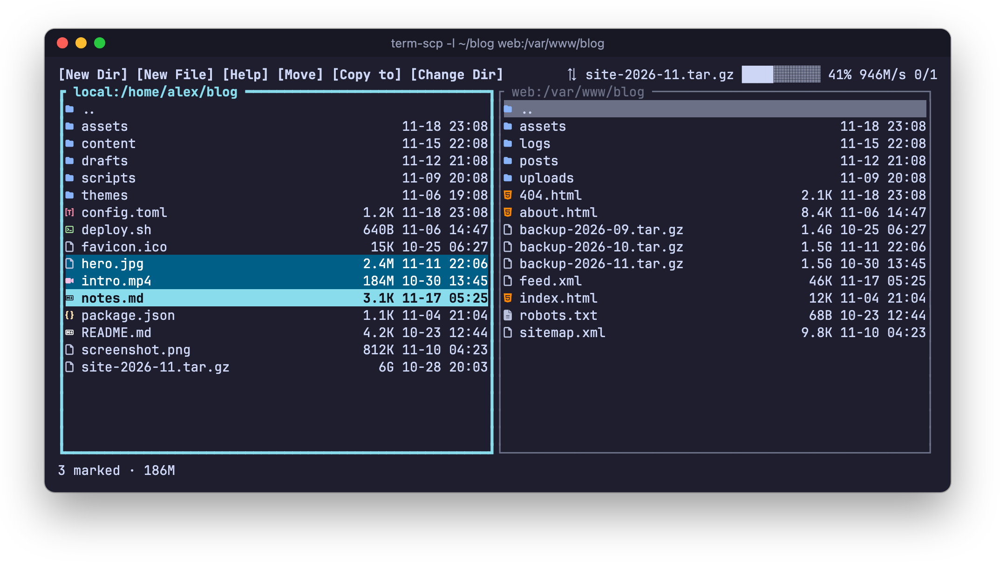

# term-scp

A file manager for the terminal with two panes: your machine on the left and an SSH host on the right, or two SSH hosts side by side. You copy and move files between the two panes.

<p align="center">
  
</p>

- Drag files from one pane to the other, right-click a file for a menu, and double-click a folder to open it.
- Preview text, images, audio and video before you copy them.
- Run up to 4 transfers at once in the background, and keep browsing while they run.
- term-scp runs your own `ssh`, so your `~/.ssh/config`, your agent and your `known_hosts` apply as they are.

## Install

You need:
- macOS or Linux, and Rust 1.88 or newer
- `ssh` from OpenSSH on your `PATH`, and SFTP enabled on the host, which is the default
- a Nerd Font in your terminal to show icons beside the files, or the `--no-icons` option
- optionally, `ffmpeg` with `ffprobe` and `ffplay` on your `PATH`, to preview audio and video

```bash
git clone https://github.com/nugejus/term-scp && cd term-scp
cargo install --path .
```

To complete options, hosts and folders with `Tab` in zsh, bash or nushell, see [docs/completions.md](docs/completions.md).

## Usage

```bash
term-scp HOST:DIR                 # the local pane shows the current folder
term-scp HOST:DIR -l ~/Downloads  # the local pane shows ~/Downloads
term-scp HOST:DIR HOST2:DIR2      # two hosts, and no local pane
```

| Key               | Action                                          |
|-------------------|-------------------------------------------------|
| `↑` / `↓`         | Move the cursor up or down                      |
| `Tab`             | Switch to the other pane                        |
| `Enter`           | Open the folder, or preview the file            |
| `Backspace`       | Go to the parent folder                         |
| `Shift` `↑` / `↓` | Select a range of files                         |
| `c`               | Copy the selection into the other pane's folder |
| `Shift` `C`       | Copy the selection to a path that you type      |
| `m`               | Move the selection to a path that you type      |
| `d`               | Delete the selection                            |
| `r`               | Rename the file under the cursor                |
| `f`               | Filter the list by name                         |
| `?`               | Show all the keys                               |
| `q`               | Quit                                            |

## Documentation

- [Usage](docs/usage.md): the options, all the keys, and the mouse
- [File operations](docs/file-operations.md): copying to a path, moving, deleting, renaming and filtering
- [Preview](docs/preview.md)
- [Transfers and the connection](docs/transfers.md)
- [Tab completion](docs/completions.md)

## Not supported yet

- Editing files, or opening them in another app
- Cancelling a single transfer. Quitting cancels all the transfers and leaves their `.term-scp-part` files behind.
- Dropping files from Finder, or pasting. Pasted text arrives as key presses, so a `c` in it starts a copy and a `q` quits.
