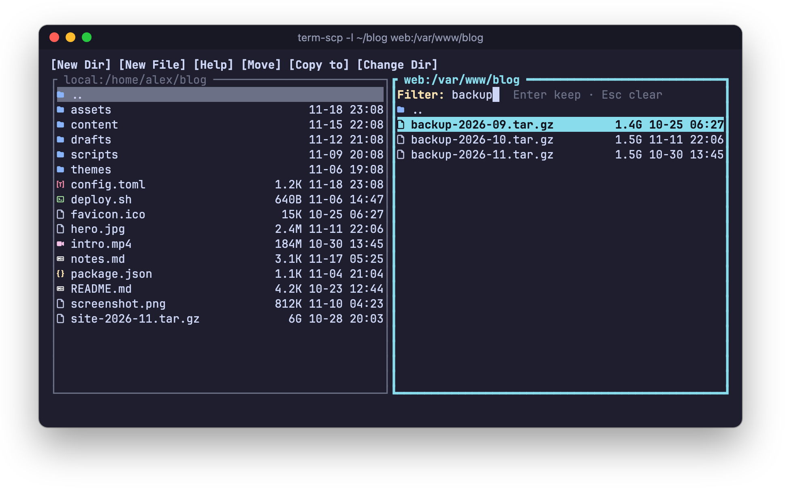

# File operations

## Copy to and Move

`Shift` `C` and `m` open a line with the destination filled in: `<other pane's folder>/<name>` for one file, the other pane's folder for several. The box is a third of the screen wide; a long path wraps.
- Edit the last part to copy under a new name.
- Edit the rest to copy somewhere else on the other side. `~` is the other side's home.
- A path that ends in `/`, or is an existing folder with another name, puts the files inside it. That folder must already exist; term-scp doesn't create it.
- `Ctrl` `U` clears the line. `Enter` confirms; `Esc` or an empty line cancels.

Folders are copied with everything in them. A folder copied onto an existing folder of the same name is merged into it.

Move deletes a source only after its copy succeeded, and a folder only if everything in it was moved. A symlink to a folder is copied as its contents, and only the link is removed.

When a file is already there, you are asked:

```
[o] Overwrite  [s] Skip  [a] Overwrite all  [Esc] Cancel job
```

- The answer applies to that transfer only. `a` holds for the rest of it.
- Other transfers keep running. Their questions wait their turn.

## Delete, rename and filter

- `d` asks `Delete "name"? [y/N]` (or `Delete 3 items?`); only `y` deletes. Folders go with everything in them. A symlink is removed, never what it points to. A file that fails doesn't stop the rest; the bottom line shows the last error.
- `r` opens a line with the name. A name that already exists is refused, never replaced. A path (`../x`, `~/x`) moves the file on the same side.
- `f` opens a bar at the top of the pane. The list narrows as you type to names that contain the text, ignoring case; it is plain text, not a regex or a wildcard.
  - `Enter` keeps the filter; the bar stays to show it. `f` again edits it.
  - `Esc` in the bar clears it, and so does opening another folder.
  - Marks on files the filter hides are dropped, so a copy or delete only takes what you see.

<p align="center">
  
  <br><sub><code>f</code> then <code>backup</code>: the list narrows as you type</sub>
</p>
