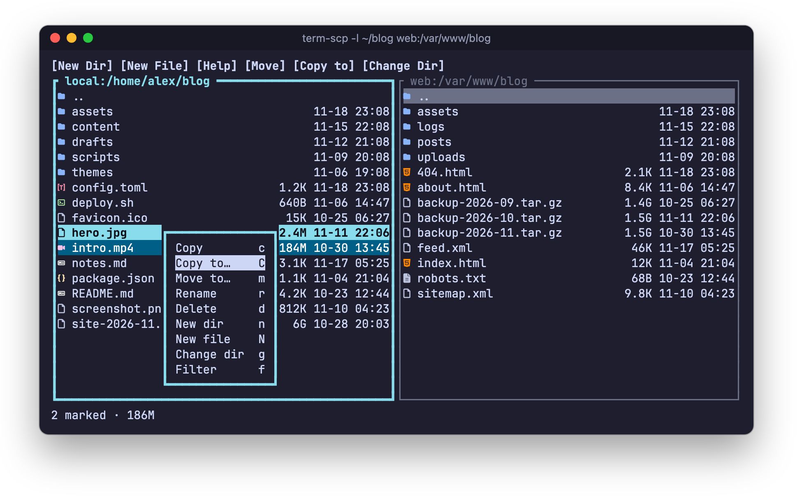
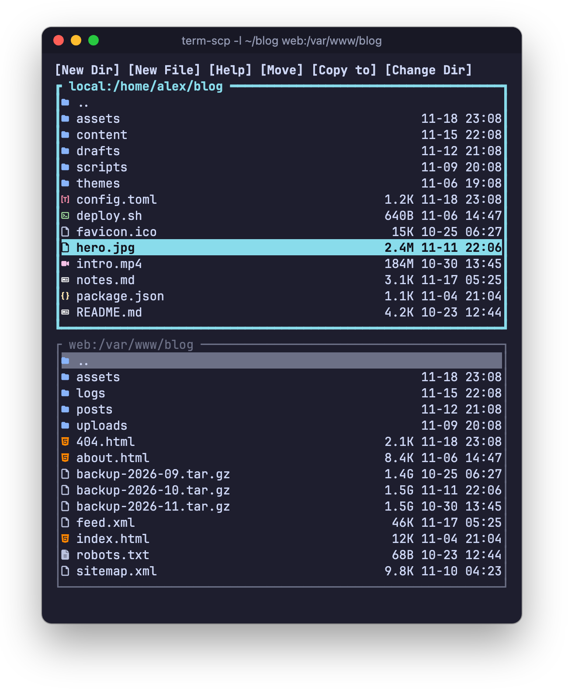

# Usage

## Command line

```bash
term-scp HOST:DIR                                 # local pane starts in the current folder
term-scp HOST:DIR -l ~/Downloads                  # local pane starts in another folder
term-scp HOST:DIR HOST2:DIR2                      # two hosts, no local pane
term-scp HOST:DIR [-P PORT] [-i KEY] [-o OPT]...  # passed to ssh as -p / -i / -o
term-scp HOST:DIR --no-icons                      # no Nerd Font file icons
```

`HOST` is anything `ssh` accepts; an IPv6 address goes in brackets: `[::1]:/tmp`. A relative `DIR`, or one starting with `~`, is under the remote home; `HOST:` alone opens it. `-o` takes any ssh option except the ones term-scp sets itself (see [Connection](transfers.md#connection)).

With two hosts, `-P`, `-i` and `-o` apply to both; put anything for one host only in `~/.ssh/config`. `-l` has no use there and is refused. Files copied between the hosts pass through your machine; nothing is stored on it.

## Keys

| Key                         | Action                                   |
|-----------------------------|------------------------------------------|
| `↑` / `↓`                   | Previous / next file                     |
| `Shift` `↑` / `↓`           | Select a range; going back shrinks it    |
| `15` `↓`                    | 15 files down; any number, also with `↑` and `Shift` |
| `PgUp` / `PgDn`             | Page up / down                           |
| `Home` / `End`              | First / last file                        |
| `Backspace`                 | Parent folder                            |
| `Enter`                     | Open the folder, or preview the file (see [Preview](preview.md)) |
| `←` / `→`                   | Left / right pane                        |
| `Tab`                       | Switch pane                              |
| `Esc`                       | Clear the marks                          |
| `c`                         | Copy the selection into the other pane's folder |
| `Shift` `C`                 | Copy to a path you type, e.g. a new name (see [Copy to and Move](file-operations.md#copy-to-and-move)) |
| `m`                         | Move to a path you type                  |
| `n`                         | New folder                               |
| `Shift` `N`                 | New empty file                           |
| `g`                         | Change folder; the line starts with the current one |
| `d`                         | Delete the selection; asks first         |
| `r`                         | Rename the file under the cursor         |
| `f`                         | Filter the list by name (see [Delete, rename and filter](file-operations.md#delete-rename-and-filter)) |
| `Ctrl` `R`                  | Refresh the focused pane                 |
| `?`                         | Show these keys                          |
| `q` / `Ctrl` `C`            | Quit; asks first while transfers run     |

The selection is the marked files, or the file under the cursor when nothing is marked. `..` is never part of it.
- Moving the cursor without `Shift` (`↑` / `↓`, `PgUp` / `PgDn`, `Home` / `End`) clears the marks, and so does opening another folder. A copy and `Ctrl` `R` keep them.
- The bottom line shows how many files are marked in the focused pane and their size (folders not counted), and the last message or error. The next key clears the message.
- The number you type before `↑` / `↓` shows in the bottom line; any other key drops it.

## Mouse

The toolbar buttons do what their keys do. Everything is also clickable; double-click opens a folder or previews a file, and the wheel moves the cursor in the pane under the pointer without focusing it. Drag a file onto the other pane to copy it into that pane's folder, or onto a folder row other than `..` to copy into that folder. Its dimmed name follows the pointer. Dragging a marked file takes all marked files.

Right-click a file for a menu: copy, copy to, move, rename, delete, new folder, new file, change folder and filter, each with its key beside it. It acts on that file, or on all marked files when it is one of them. Pick with the mouse, `↑` `↓` `Enter` or the key; `Esc` or a click elsewhere closes it. Some terminals keep right-click for their own menu; turn that off to get this one.

<p align="center">
  
</p>

## Layout

On a window taller than it is wide, the panes stack: left on top, right below.

<p align="center">
  
</p>
